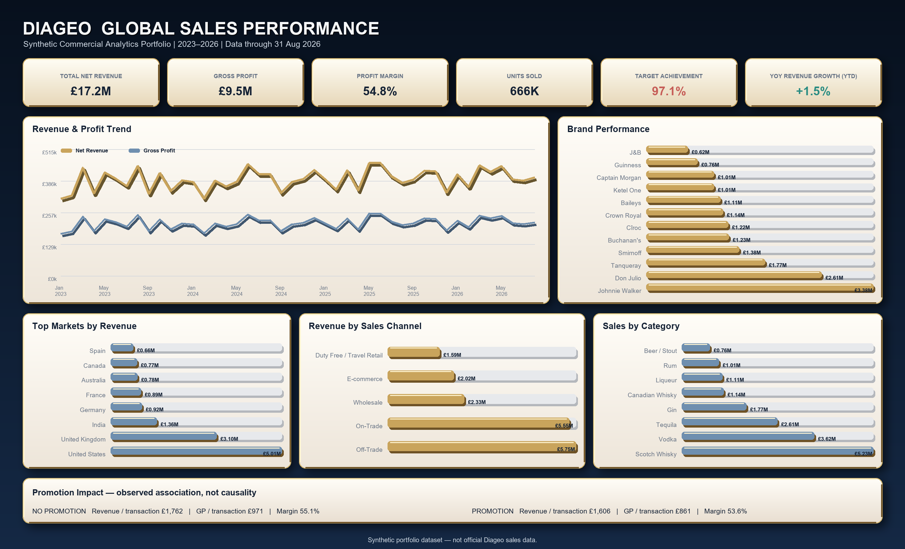

# DIAGEO | Global Sales Performance Dashboard

An executive commercial analytics portfolio project built with Python, Excel, Power BI and Tableau-ready specifications. The project analyses 10,000 synthetic global beverage transactions across brands, markets, categories, channels, profitability, targets and promotions.

> **Synthetic portfolio dataset — not official Diageo sales data.** This project is not affiliated with, endorsed by, or based on confidential data from Diageo plc.



## Business objective

The dashboard helps commercial leaders answer five questions:

1. Are revenue, profit and targets on track?
2. Which brands, categories and markets generate the most value?
3. Where are strong margins not matched by scale?
4. Which channels and markets have the largest target gaps?
5. How do promotional and non-promotional transactions differ?

## Validated headline results

| KPI | Result |
|---|---:|
| Net Revenue | £17.25m |
| Gross Profit | £9.45m |
| Weighted Profit Margin | 54.8% |
| Units Sold | 666,328 |
| Target Achievement | 97.1% |
| Target Variance | −£507.1k |
| Jan–Aug 2026 revenue growth vs Jan–Aug 2025 | +1.5% |

## Selected synthetic-data insights

- Johnnie Walker is the largest brand at £3.38m revenue.
- Don Julio generates £2.61m revenue and the highest brand margin at 59.6%.
- The United States and United Kingdom contribute 47.0% of portfolio revenue.
- Promotional transactions show 8.8% lower revenue per transaction and a 1.54 percentage-point lower margin than non-promotional transactions. This is an observed association, not a causal estimate.

## Deliverables

- **Excel:** interactive executive workbook with Year, Region, Brand and Channel selectors, formula-driven KPI cards, linked charts, supporting analysis sheets and source data.
- **Python:** reproducible validation, preparation and high-resolution dashboard-generation scripts.
- **Power BI:** import-ready dataset, complete DAX measure definitions, model instructions and a reusable report theme.
- **Tableau:** build-ready worksheet, calculation, parameter, filter, tooltip, action and dashboard-layout instructions.

## Repository structure

```text
├── data/
│   ├── raw/                 # Original synthetic transactions
│   └── processed/           # Power BI-ready enriched dataset
├── excel/                   # Interactive Excel dashboard
├── images/                  # Dashboard preview
├── power-bi/                # DAX guide and report theme
├── python/                  # Data pipeline and dashboard generator
├── tableau/                 # Tableau build guide
├── requirements.txt
└── README.md
```

## Run the Python workflow

```bash
python -m venv .venv
# Windows: .venv\Scripts\activate
# macOS/Linux: source .venv/bin/activate
pip install -r requirements.txt
python python/diageo_pipeline.py
python python/diageo_python_dashboard.py
```

The pipeline validates transaction uniqueness, missing values, date fields, revenue calculations and gross-profit reconciliation before producing the processed reporting table.

## Analytical approach

- Profit Margin = `SUM(Gross Profit) / SUM(Net Revenue)`
- Target Achievement = `SUM(Net Revenue) / SUM(Sales Target)`
- Target Variance = `SUM(Net Revenue) - SUM(Sales Target)`
- Comparable YTD Growth = Jan–Aug 2026 revenue versus Jan–Aug 2025 revenue
- Promotion analysis uses per-transaction and weighted profitability measures and does not claim causality

## Portfolio positioning

This project demonstrates commercial analytics, KPI design, sales and profitability analysis, target-versus-actual reporting, data validation, dashboard development, business storytelling and stakeholder-focused reporting.

**CV summary:** Built a cross-platform commercial sales dashboard covering 10,000 synthetic transactions, with validated revenue, profitability, target, market, channel and promotion KPIs across Python, Excel, Power BI and Tableau.

## Disclaimer

Brand names may be real, but all transaction-level revenue, cost, profit, customer, target and market-performance values are simulated. Nothing in this repository should be interpreted as official Diageo reporting.
